# Keep Password

面向开发和运维的本地密码管理器：网站、服务器、数据库、SSH 密钥、API 凭据一处管理，数据不出本机。

[](https://github.com/a2king/keep-password/releases/latest)
[](https://github.com/a2king/keep-password/blob/main/LICENSE)
[](https://github.com/a2king/keep-password/releases/latest)
[](https://dotnet.microsoft.com/download/dotnet/8.0)

<p align="center">
  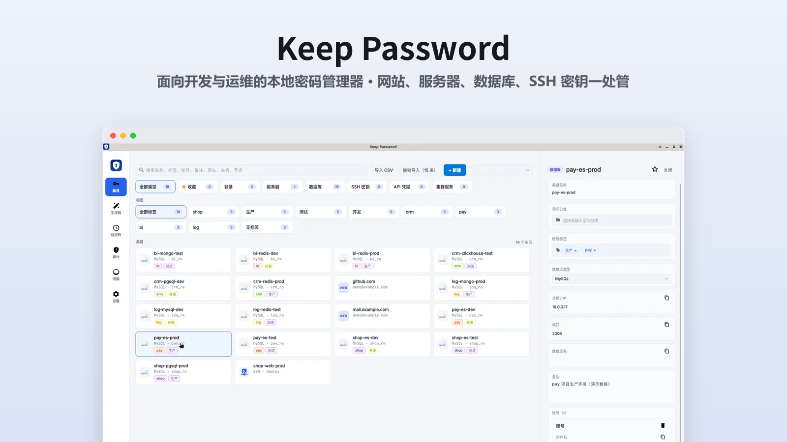
</p>

<p align="center">
  <a href="https://github.com/a2king/keep-password/releases/latest"><strong>下载最新版 →</strong></a>
</p>

界面用 Avalonia，风格接近 1Password：深色侧栏、卡片列表、右侧滑出的详情面板。同一套代码可以发布到 Windows、macOS 和 Linux。保险库文件与系统无关，换电脑时可以直接拷贝打开。

没有云同步，所有数据只在本机加密保存。会联网的功能只有：手动触发的「泄露检查」（只发送密码哈希前 5 位），以及检查 / 下载 GitHub 发布的更新安装包。

> **说明：** Windows / macOS 支持桌面程序快捷键自动填充（macOS 需授予辅助功能权限）；Linux 程序补全尚未实现。三个平台均可使用浏览器扩展。自动填充界面截图待补。

## 目录

- [为什么选 Keep Password](#为什么选-keep-password)
- [功能截图](#功能截图)
- [快速开始](#快速开始)
- [功能一览](#功能一览)
- [两把锁](#两把锁)
- [数据目录](#数据目录)
- [Windows 安装与卸载](#windows-安装与卸载)
- [条目](#条目)
- [首次使用补充](#首次使用补充)
- [密码生成器与安全检查](#密码生成器与安全检查)
- [CSV 导入](#csv-导入)
- [验证码](#验证码)
- [补全](#补全)
- [构建和运行](#构建和运行)
- [测试与验证](#测试与验证)

## 为什么选 Keep Password

- **纯本地加密**：AES-256-GCM + Argon2id，数据与密钥不出本机，没有云同步账号。
- **面向运维的条目类型**：登录之外还可管理服务器、数据库、SSH 密钥、API 凭据和集群节点。
- **自动填充需短密钥确认**：浏览器扩展与 Windows / macOS 程序快捷键填充前都要再确认短密钥，降低误填与误触风险。
- **内置 TOTP**：支持 Base32 / otpauth://，Windows 可扫屏识别二维码。
- **安全审计**：空密码、弱密码、跨站重复使用检测；可选 Have I Been Pwned k-匿名泄露检查。
- **仿 1Password 的 CSV 导入**：列映射、预览、可撤销导入，方便从其它密码管理器迁入。

## 功能截图

| | |
| :---: | :---: |
| 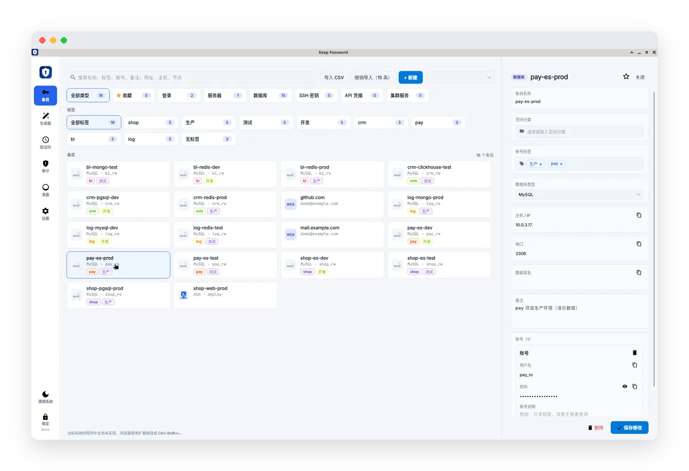<br/>主界面总览 | 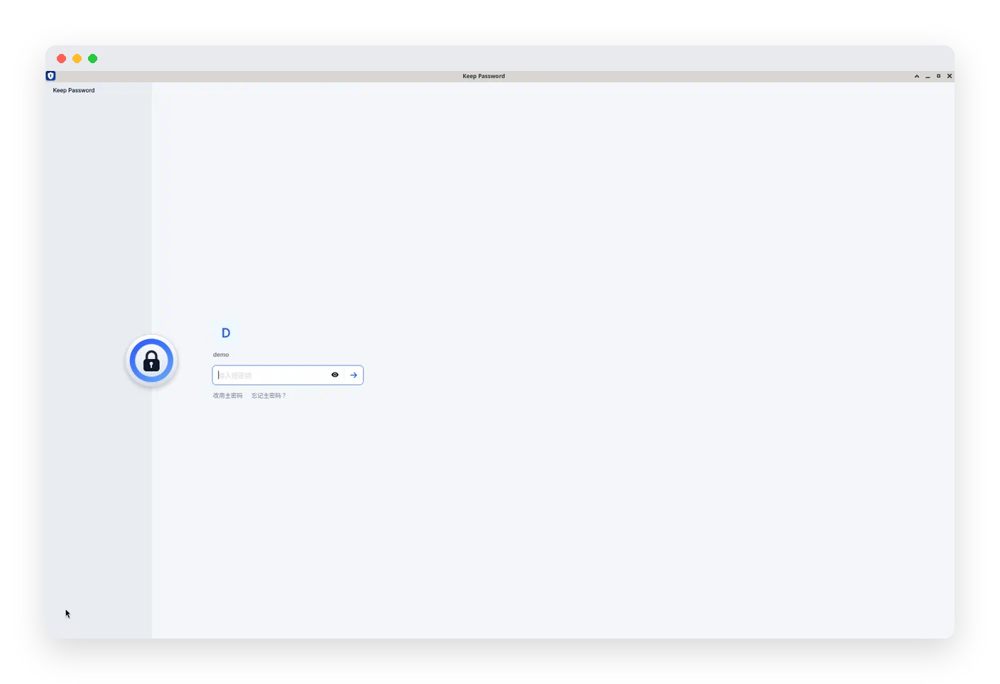<br/>解锁页 |
| 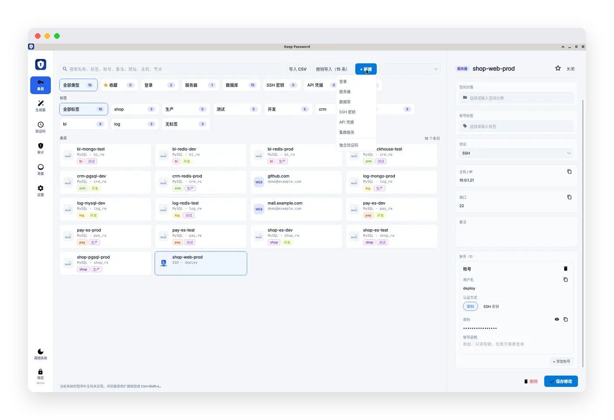<br/>多类型条目 | 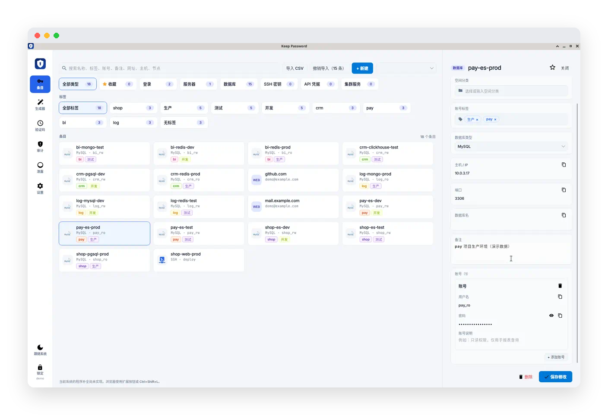<br/>数据库详情 |
| 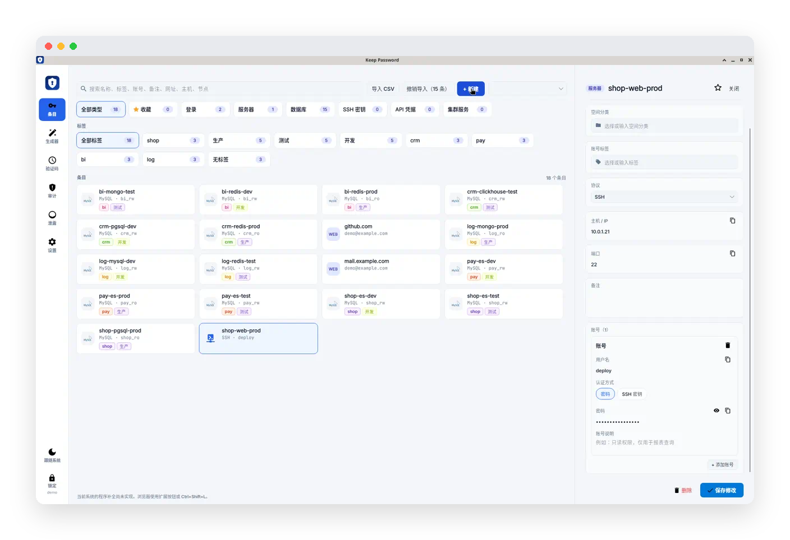<br/>服务器详情 | 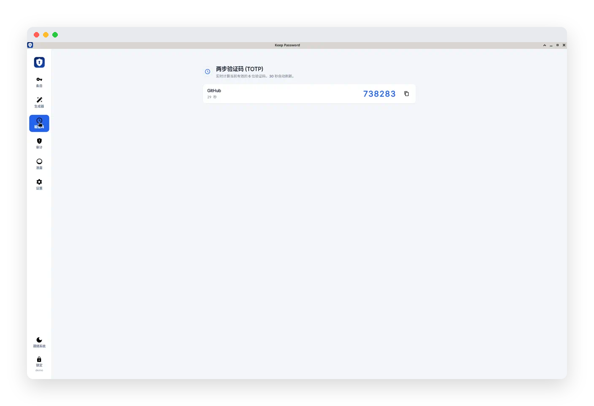<br/>验证码（TOTP） |
| 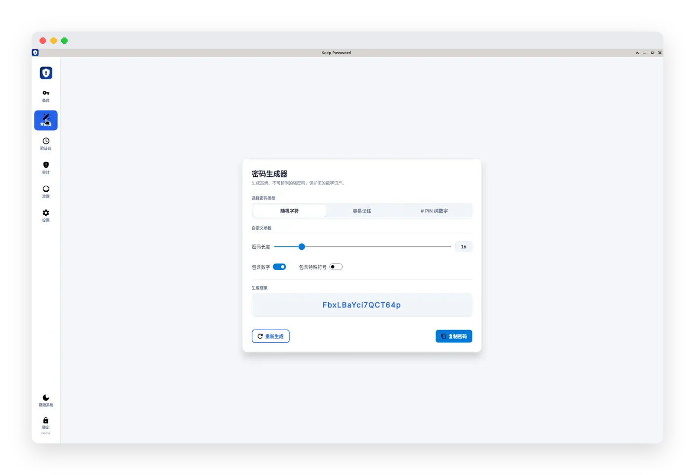<br/>密码生成器 | 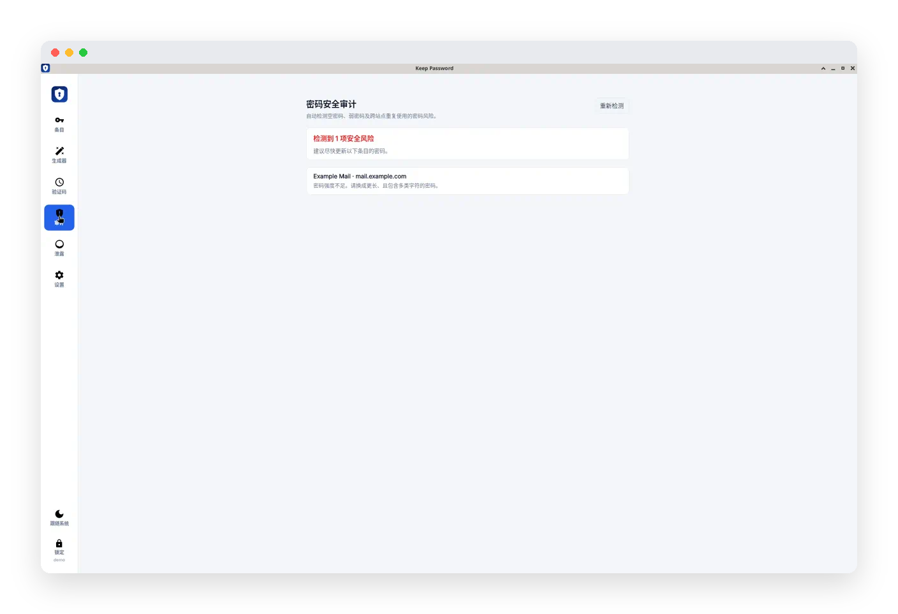<br/>安全审计 |
| 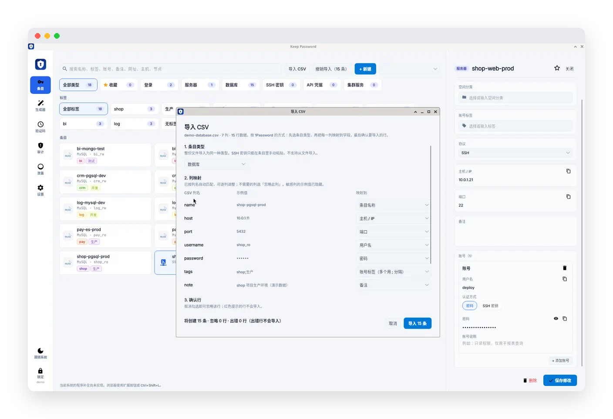<br/>CSV 导入 | 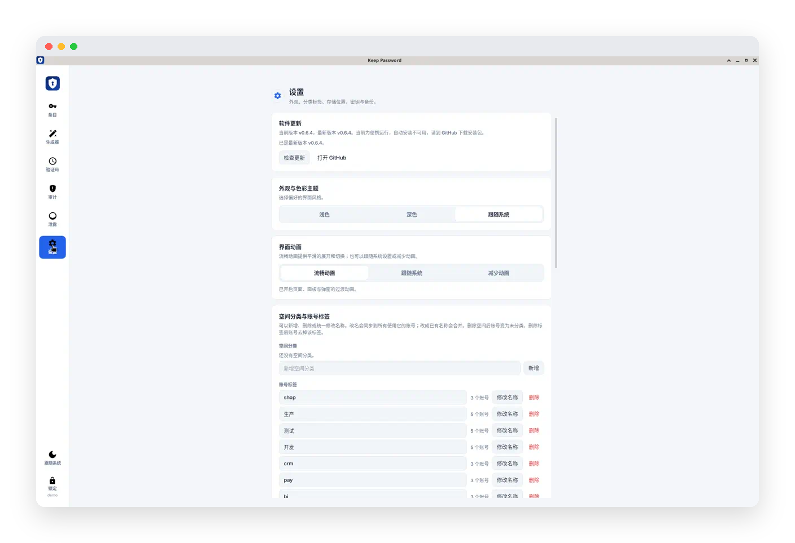<br/>设置 |

## 快速开始

### 下载安装（Windows）

**正式安装包是自包含的，不需要安装 .NET。**

1. 打开 [Releases](https://github.com/a2king/keep-password/releases/latest)，下载 `KeepPassword-Setup-win-x64.exe`。
2. 运行安装程序，选择目录并完成安装（也可解压 `KeepPassword-win-x64.zip` 便携使用）。
3. 从开始菜单或桌面快捷方式启动 Keep Password。

### 首次创建保险库

1. 在解锁页创建保险库：填写账号、主密码、短密钥（及确认项）。
2. 按提示选择文件夹，永久保存加密密钥文件（`.kpkey`）。
3. 之后日常解锁通常只需短密钥；关闭窗口会隐藏到托盘，托盘右键「退出」才结束程序。

---

## 功能一览

- **多类型条目**：登录、服务器、数据库、SSH 密钥、API 凭据、集群服务；一条记录可以有多个账号，支持自定义字段、收藏、空间分类和彩色标签。
- **验证码（TOTP）**：手填密钥、粘贴 otpauth:// 链接，或在 Windows 上扫描屏幕二维码。
- **自动填充**：Chrome / Edge 扩展；Windows 普通程序按快捷键 `Ctrl+Alt+K` 触发；macOS 普通程序**聚焦密码框即提示**（快捷键仍可用，需允许辅助功能）；每次填入前都要确认短密钥。Linux 的程序补全尚未实现。
- **密码生成器**：随机字符、容易记住的单词、PIN 纯数字三种模式。
- **安全检查**：审计空密码、弱密码和跨站重复使用；泄露检查使用 k-匿名查询。
- **CSV 导入导出**：仿 1Password 的导入向导（列映射、预览、可撤销）；明文导出需要验证加密密钥。
- **加密备份与还原**、**独立加密密钥文件**、**主题切换**、**界面动画偏好**、**托盘常驻**、**GitHub 自动更新**（设置页检查与下载，启动静默提示）。

<details>
<summary><strong>两把锁</strong>（加密模型、密钥文件、自动锁定）</summary>

## 两把锁

首次运行要设置三项：

- 账号
- 主密码
- 固定短密钥

保险库用独立生成的 256 位随机密钥进行 AES-256-GCM 加密。主密码通过 Argon2id 派生保护密钥，用于加密这把随机密钥。更换主密码只更新保护层，数据密钥和数据密文均保持不变。短密钥用于本机快速解锁，解锁信息与保险库文件分开保存；主密码和短密钥都不明文落盘。

创建后会显示长期加密密钥，必须在自选文件夹保存 `.kpkey` 文件后才能进入保险库。取消或保存失败后，下次解锁继续提示。密钥文件含明文密钥，应永久保存并与备份分开保管。设置中的明文 CSV 导出、加密备份还原以及忘记主密码后的重置，都要求提供对应的密钥文件或完整 `KP2-` 密钥。

新版导出的加密备份不包含主密码保护层，只能用对应的加密密钥还原。主密码更换前后的新版备份共用同一把密钥。旧版保险库可以继续解锁，在新版设置中更换一次主密码即可升级并生成密钥文件；之后重新导出新版备份。升级后的保险库不能用旧客户端打开。详见 [加密密钥说明](docs/encryption-keys.md)。

创建保险库时设置主密码和短密钥。已经建好、还没开通过短密钥解锁的保险库，第一次打开只输入主密码。之后再次打开只输入短密钥。账号已经写在保险库文件里，解锁页会显示，不用再填。忘记短密钥时可以改用主密码。只把保险库文件拷到另一台电脑时，需要再用一次主密码。

补全前会再弹一次短密钥确认，即使刚刚解锁过。设置里可以修改短密钥，提交前必须再输入主密码并且验证通过。

主密码和短密钥只接受可打印的英文字符（字母、数字、英文符号和空格）。在这些输入框里，中文输入法会自动切到英文模式而不是切换键盘布局；含中文的输入或粘贴整次拒绝。

自动锁定：空闲 5 分钟、锁屏或休眠后自动锁定，锁定时保险库内容立即隐藏。复制到剪贴板的密码 30 秒后自动清除。

</details>

<details>
<summary><strong>数据目录</strong></summary>

## 数据目录

保险库文件名都是 `vault.kpvault`。默认缓存目录：

| 系统 | 目录 |
| --- | --- |
| Windows | `%LOCALAPPDATA%\KeepPassword` |
| macOS | `~/Library/Application Support/KeepPassword` |
| Linux | `~/.local/share/KeepPassword` |

解锁页和设置里可以改缓存目录。选定新目录后，会把当前目录里的文件全部转过去，再删除原来的目录。目录记在单独的配置文件里，不跟缓存文件放在一起：

| 系统 | 配置文件 |
| --- | --- |
| Windows | `%APPDATA%\KeepPassword\settings.json` |
| macOS | `~/Library/Preferences/KeepPassword/settings.json` |
| Linux | `~/.config/KeepPassword/settings.json` |

</details>

<details>
<summary><strong>Windows 安装与卸载</strong>（覆盖安装、卸载选项、打包命令）</summary>

## Windows 安装与卸载

**正式安装包是自包含的，不需要安装 .NET，也不需要其它运行库。**  
（开发者在本机编译时才需要 .NET 8 SDK。）

推荐使用安装程序：

1. 运行 `KeepPassword-Setup-win-x64.exe`。
2. 选择安装目录，可勾选：开始菜单快捷方式、桌面快捷方式、安装完成后立即运行。
3. 安装过程有进度条：先解压压缩包，再复制到目标目录；写完后可查看日志，再点「下一步」进入完成页。
4. 完成后点「完成」关闭安装窗口。若勾选了立即运行，主程序会自动启动。
5. 默认安装到 `%LOCALAPPDATA%\Programs\KeepPassword`。覆盖安装会清理旧版本残留程序文件，不会动缓存里的保险库。旧版仍在运行时会弹窗询问是否退出占用进程后再继续。
6. 安装包是压缩后的自包含运行时（主程序与 Native Host 共用一份），**不需要安装 .NET**。
7. 卸载运行安装目录里的 `Uninstall.exe`。可勾选「同时删除缓存目录」，**默认不勾选**。

也可以解压便携包 `KeepPassword-win-x64.zip` 直接使用。

打 Windows 安装包（仅打包机器需要 .NET 8 SDK）：

```bash
./scripts/package-windows.sh /tmp/kp-windows-package
```

产物在输出目录：`KeepPassword-Setup-win-x64.exe`、`KeepPassword-win-x64.zip`。

</details>

<details>
<summary><strong>条目</strong>（类型字段、列表与详情交互）</summary>

## 条目

| 类型 | 主要字段 |
| --- | --- |
| 登录 | 网址、账号（用户名 / 密码 / 验证码密钥）、备注 |
| 服务器 | 协议（SSH、SFTP、RDP、FTP、FTPS、VNC、Telnet、通用）、主机、端口；SSH / SFTP 账号可改用 SSH 密钥认证 |
| 数据库 | 类型（MySQL、PostgreSQL、SQL Server、SQLite、Redis、MongoDB、Elasticsearch、OSS、ClickHouse、Doris）、主机、端口等 |
| SSH 密钥 | 私钥、公钥，自动计算 SHA256 指纹；服务器和集群可以引用它 |
| API 凭据 | 密钥等敏感字段 |
| 集群服务 | 多个节点（主机 / IP），所有节点共用账号和密码或密钥 |

- 一条记录可以添加多个账号，并且可以加自定义字段（文本或敏感）。条目类型保存后不能修改。
- 服务器和数据库按协议 / 驱动显示品牌图标，切换协议时自动填默认端口。
- 列表顶部可以按类型、收藏、空间和标签筛选；标签多时筛选区自动增高，不出现滚动条。
- 搜索范围：名称、标签、账号、备注、网址、主机、节点。搜索框右侧有清除按钮，按 Esc 也能清空。
- 点击卡片后详情从右侧滑出；点「关闭」或列表空白处收起，有未保存的修改时会先确认。
- 每个字段都可以单独复制；敏感字段默认隐藏，点眼睛图标查看。
- 新建菜单里的「独立验证码」用于只保存验证码的记录。

</details>

<details>
<summary><strong>首次使用补充</strong>（托盘、动画偏好）</summary>

## 首次使用补充

1. Windows 可用安装程序；开发时也可安装 [.NET 8 SDK](https://dotnet.microsoft.com/download/dotnet/8.0) 后直接运行。
2. 在解锁页创建保险库：账号、主密码、确认主密码、短密钥、确认短密钥；随后按提示选择文件夹，永久保存加密密钥文件。
3. 之后每次打开只输入短密钥。还没开启短密钥解锁的旧保险库，第一次只输入主密码。主窗口可以锁定，或从托盘锁定。关闭主窗口只是隐藏到托盘，程序继续运行；只有托盘图标右键「退出」才会结束程序。窗口隐藏后再次启动程序，会调出已在运行的窗口。

在设置的“界面动画”中可选择“流畅动画”“跟随系统”或“减少动画”。默认启用流畅动画，详情面板与页面切换不受 Windows 动画关闭的影响；需要遵循系统偏好时可切换为“跟随系统”。锁定始终立即隐藏保险库内容。

</details>

<details>
<summary><strong>密码生成器与安全检查</strong></summary>

## 密码生成器与安全检查

- 生成器：随机字符（8–64 位，可选包含数字和特殊符号）、容易记住的单词组合（可选首字母大写、使用完整单词）、PIN 纯数字。首次进入自动生成一次，左侧重新生成，右侧复制。编辑条目时，密码框旁的「生成」按钮会直接填入 16 位字母和数字。
- 审计：检测空密码、常见弱密码和跨条目重复使用的密码。
- 泄露检查：手动触发，使用 [Have I Been Pwned](https://haveibeenpwned.com/Passwords) 的 k-匿名范围查询，只发送密码 SHA-1 的前 5 位，不上传明文或完整哈希。

</details>

<details>
<summary><strong>CSV 导入</strong>（向导、格式示例、明文导出）</summary>

## CSV 导入

点列表顶部的「导入 CSV」打开导入向导，流程参照 1Password：

1. 选择条目类型。
2. 列映射：按列名自动匹配，可以逐列调整，不需要的列选「忽略此列」；敏感列的示例值会隐藏。
3. 预览并确认要导入的行，缺名称或缺账号的行会标出原因。

导入后列表顶部会出现「撤销导入」，可以一次删除本次导入创建的全部条目（导入后修改过的也会删除）。

常见的五列格式如下，表头大小写不限：

```csv
name,url,username,password,note
GitHub,https://github.com,ada,"p,ass",工作账号
邮箱,https://mail.example.com,ada@example.com,hunter2,个人
```

逗号和 Tab 都可以。密码里如果有逗号，用双引号包起来。标签列有多个标签时用 `;` 分隔（全角 `；` 也可以），例如 `生产;只读`。验证码列可以是 Base32 密钥或 otpauth:// 链接。

明文导出在「设置 → 明文导出」里，需要先验证当前保险库的加密密钥，每个账号导出一行。文件包含明文密码、验证码密钥和私钥，请自行保管。

</details>

<details>
<summary><strong>验证码</strong>（TOTP、扫码）</summary>

## 验证码

TOTP，RFC 6238。默认 SHA-1、6 位、30 秒；otpauth:// 链接里写了 6–8 位、其它周期或 SHA-256 / SHA-512 时按链接生成。密钥可以手填 Base32 或 otpauth:// 链接，Windows 上也可以点密钥旁的扫码图标识别屏幕上的二维码（截图只在内存里识别，用完清零，不落盘，扫描时本窗口不参与截图）。可以写在某条登录记录上，也可以单独新建一条（只填名称和密钥）。验证码页面会列出当前码和剩余秒数。

</details>

<details>
<summary><strong>补全</strong>（Windows / macOS 程序、浏览器扩展、平台限制）</summary>

## 补全

发现密码框、选择条目、验证短密钥、填入用户名和密码，走同一套接口。浏览器按密码框所在页面的网址匹配登录条目；普通桌面程序无法仅凭窗口标题确认服务地址，因此显示账号列表，由用户搜索、选择并核对目标。

- Windows：不监视焦点，也不会因为出现密码框就弹窗。先在目标程序里点击密码框，再按全局快捷键（默认 `Ctrl+Alt+K`，可在「设置 → 程序自动填充快捷键」中修改）。普通程序用 UI Automation 识别 `IsPassword` 输入框，可选择登录、服务器、数据库、集群的密码账号；SSH 密钥认证和只有验证码的账号不参与。没有明确识别到用户名框时只填密码，避免改动数据库连接里的主机、端口等字段。填入前都要再输入短密钥。
- macOS：用系统 Accessibility API 识别安全文本框。**聚焦密码框会自动弹出选账号提示**（与浏览器扩展类似）；全局快捷键仍可用作兜底。首次使用需在「系统设置 → 隐私与安全性 → 辅助功能」中允许 Keep Password。写入失败时会降级为键盘模拟。自绘、未暴露辅助功能属性的控件可能无法识别，可从保险库复制密码。浏览器网页仍请用扩展，桌面端会忽略 Chrome / Safari 等浏览器进程以免重复提示。
- DBX、飞书等应用只有在向系统暴露标准可访问性密码属性时才能被识别；自绘、未启用可访问性的控件仍可能没有提示。Windows 上也不会向管理员权限的目标输入。遇到不支持的控件可手动复制密码。
- 浏览器：Chrome / Edge 使用扩展和 Native Messaging。保险库首次在本机解锁后会生成仅含账号元数据的本机保护索引；之后即使桌面端处于锁定状态，聚焦密码框仍会显示候选账号，只有选择账号并输入短密钥时才临时解密并填充。扩展按钮和 `Ctrl+Shift+L` 仍可手动重新打开候选框。**HTTP Basic 等浏览器原生认证弹窗无法由扩展填充**（不在网页 DOM 内）。
- Linux：程序补全仍为接口占位（AT-SPI 以后再接）。浏览器扩展和本机消息协议是同一份，客户端在三个系统上都会听本机端口。

扩展在 `extension/`，Manifest V3。安装桌面端不会自动连接浏览器。首次需要在浏览器扩展管理页加载 `extension` 文件夹，复制真实扩展 ID，再运行 `extension/register-windows.ps1 -ExtensionId "实际扩展ID"`。Windows 发布包的宿主是安装根目录中的 `KeepPassword.NativeHost.exe`。完整步骤及排错说明见 [浏览器连接说明](extension/README.md)。

> 自动填充流程截图待补。

</details>

<details>
<summary><strong>构建和运行</strong>（本地调试、打包、发布资源）</summary>

## 构建和运行

在仓库根目录：

```bash
dotnet test
dotnet run --project src/KeepPassword.App
```

### Windows 本地调试

.NET 8 SDK 如果装在用户目录 `%LOCALAPPDATA%\dotnet`（没加进系统 PATH），每个新开的 PowerShell 终端先执行一次：

```powershell
$env:PATH = "$env:LOCALAPPDATA\dotnet;" + $env:PATH
```

然后在仓库根目录编译、测试、启动：

```powershell
dotnet build KeepPassword.sln -c Release --nologo
dotnet test KeepPassword.sln -c Release --nologo --no-build
dotnet run --project src\KeepPassword.App -c Release
```

也可以直接运行编译产物 `src\KeepPassword.App\bin\Release\net8.0\KeepPassword.exe`。如果已经装了正式版并在运行（包括托盘），先退出再启动本地版本。

打 Windows 安装包：

```powershell
pwsh -NoProfile -File artifacts\package.ps1 -Version v0.8.0
```

产物在 `artifacts\v0.8.0\`：安装程序、便携包、`KeepPassword-Chrome-Extension-v0.8.0.zip`、`KeepPassword-Edge-Extension-v0.8.0.zip`，以及安装包校验文件 `KeepPassword-Setup-win-x64.exe.sha256`。

发布到 GitHub Releases 时请一并上传：

- `KeepPassword-Setup-win-x64.exe`
- `KeepPassword-Setup-win-x64.exe.sha256`（客户端自动更新会校验）
- 可选：便携包与扩展包

安装版会在启动时静默检查最新 Release，设置页可手动检查、下载到安装目录下的 `cache\`，校验通过后再启动安装程序。便携解压版不走自动安装，可从设置打开 GitHub 发布页。

Windows 用户请直接用上面的安装包或便携包，**不要**再单独安装 .NET。

若自己发布，请使用自包含（或单文件）模式，例如：

```bash
dotnet publish src/KeepPassword.App -c Release -r win-x64 --self-contained true -p:PublishSingleFile=true -o /tmp/kp-win
```

非单文件发布时，可用 `scripts/arrange-lib-layout.sh` 整理目录；脚本会把 `hostfxr` / `coreclr` 留在 exe 旁，避免误报需要安装 .NET。

Windows 安装包请用上面的 `package-windows.sh`。

</details>

<details>
<summary><strong>测试与验证</strong></summary>

## 测试与验证

- `tests/KeepPassword.Core.Tests`：加密与密钥、解锁、备份还原、CSV 导入、TOTP（含 RFC 6238 SHA-1 / SHA-256 / SHA-512 向量）、二维码识别、自动填充匹配、缓存目录等核心逻辑。
- `tests/KeepPassword.App.Tests`：用临时保险库做的界面回归测试，覆盖加密密钥保存流程、详情抽屉动画、动画偏好和英文输入限制，不访问真实保险库。
- `extension/tests`：浏览器扩展的填充逻辑测试，运行 `node --test extension/tests/autofill.test.cjs`。
- Windows 上的手工验收清单见 [docs/windows-acceptance.md](docs/windows-acceptance.md)。
- macOS、Linux 未做完整的图形验收，程序补全在这两个平台上只有空实现。

</details>
